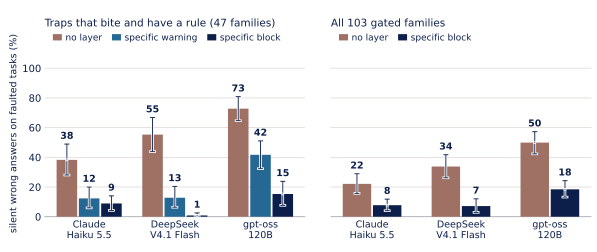

# biowarden

[](https://github.com/BrianP2002/biowarden/actions/workflows/ci.yml) [](LICENSE) [](pyproject.toml) [](CHANGELOG.md)

**Catch silent errors in bioinformatics tool calls before they run, and measure how often LLM agents make them.**

A *silent error* is a tool call that exits 0 and returns a plausible but scientifically wrong result: a BED file read as 1-based,
a Phred+64 FASTQ read as Phred+33, a log-scaled matrix treated as raw counts. Nothing in the output tells an agent, or a tired
human, that it is wrong. This project has two parts:

- a **checking layer**: 108 rules, each for one known trap, that block the call before it runs and print a one-line fix. They
  cover alignment, RNA-seq, variant, interval, sequence, protein-structure and single-cell tools ([list](#what-it-catches)). Use it
  around any shell or agent (`biowarden`) or as an MCP (Model Context Protocol) server (`biowarden-mcp`); it runs locally and
  needs no API key.
- a **benchmark**: 105 task families, each a clean and a faulted twin (the faulted one holds the trap), that measure how often
  LLM agents end with a wrong answer.

In a study [registered in advance](docs/preregistration/README.md#checking-the-freeze), the layer cut silent wrong answers from 38%, 55% and 73% to 9%, 1% and 15% for three agents,
on the 47 task families where at least one agent failed in a pilot and a rule exists, in the hardest setting, where any wrong
answer is silent. Over the 103 gated families, those that run in this setting, the same agents went from 22-50% to 7-18%
([Results](#results)).

```console
$ cd examples/bed-base && biowarden -- bcftools view -H -R regions.tsv variants.vcf.gz
FIX: cp regions.tsv regions.tsv.bed && bcftools view -H -R regions.tsv.bed variants.vcf.gz (if
  regions.tsv already holds 1-based inclusive coordinates, re-run the original command with
  --declare region_file_base=one_based_closed instead)
BLOCKED, the command did not run. bcftools.regions_file_base [index_base/T1]: bcftools reads
  regions.tsv as 1-based inclusive CHROM POS END because its name does not end in .bed or .bed.gz,
  but its 12 data lines look like BED intervals (0-based, half-open), so each interval would start
  one base early; read as 1-based it selects 17 records of variants.vcf.gz, read as BED 14
Also: bcftools.region_semantics [interval_semantics/T0]: state which interval_semantics
  convention you intend …
```

Following that FIX runs into the `Also:` rule, a second trap on the same call (does a region keep records that only overlap it,
or only those that start inside it?), answered with `--declare` ([walk-through](examples/bed-base/README.md)). In a tag such as
`[index_base/T1]`, the first word is the *convention*, a choice the tool leaves implicit (here 0- or 1-based coordinates), and
the tier says what the rule reads: T0 the command line alone, T1 also the files it names.

[Get started](#get-started) | [How it works](#how-it-works) | [Results](#results) | [What it catches](#what-it-catches) | [Cite](#citing-and-contributing)

## Get started

```bash
git clone https://github.com/BrianP2002/biowarden && cd biowarden
python3 -m venv .venv && . .venv/bin/activate    # Linux, Python 3.10+
pip install -e .                                 # samtools, bcftools, ... must be on PATH
biowarden -- bash                                # any shell or agent: supported tools are checked
# or as an MCP server (--cwd: where the tools run; use a directory you trust, see SECURITY.md):
claude mcp add biowarden -- "$PWD/.venv/bin/biowarden-mcp" --cwd /abs/path/to/data
```

**Notes.**
- `biowarden` works through *shims*, stand-in programs first on `PATH` that ask the engine. It skips a tool called by absolute path
  or put first on `PATH` later (`module load`, `conda activate`, `~/.bashrc`) and says nothing; inside it, `type -P samtools` should
  end in `/shims/samtools`. `biowarden-mcp` checks only calls made through `run_tool`, the tool it offers the agent, not the agent's
  own Bash. The results below were measured with shims plus a pre-check of the whole command string (which also sees pipeline
  stages that name no file), in a sandbox where the real tools are hidden; they do not carry over to either front end alone.
- State a convention with `--declare key=value` or `BIOWARDEN_DECLARE` (with `biowarden-mcp`: the `declared` object of `run_tool`).
  9 of the 108 rules ask for one on every call in their scope and block until it is given, even a correct call (for example a
  bcftools `view` or `query` call with `-r`, `-R`, `-t` or `-T`). A blocked shell call exits 97 (use `set -o pipefail`);
  `--mode warn` lets calls run.
- Rules were checked on the tool versions in [`supported-tools.md`](docs/supported-tools.md); the layer does not check yours. Linux
  only (CI: Ubuntu).

## How it works

<picture>
  <source media="(prefers-color-scheme: dark)" srcset="docs/figures/layers-dark.svg">
  
</picture>

*Three front ends share one engine, so a rule is written once.*

<picture>
  <source media="(prefers-color-scheme: dark)" srcset="docs/figures/decision-dark.svg">
  
</picture>

*One call, five steps. Modes: `warn`, `block` and `promoted`, the default (`biowarden-mcp` also has `off`); a rule is *promoted* when its calibration lets it block, and all 108 shipped rules are promoted, so it blocks.
The engine never rewrites a call. More in [`docs/architecture.md`](docs/architecture.md).*

## Results

Setting: generated tasks on seeds not used while writing the rules; three agents in a minimal loop with one bash tool; the hardest
wording (the task names the tool whose default is the trap, and the agent writes only a result file, so any wrong answer is
silent). Bars: no layer, the layer in `--mode warn`, the layer in its default mode; whiskers are 95% intervals over families.
The right panel and the third column use 103 of the 105 families (F4 and F34 do not run in this setting). Intervals and the
other families: [`docs/results`](docs/results/README.md).

<picture>
  <source media="(prefers-color-scheme: dark)" srcset="docs/figures/stage2_silent_errors-dark.svg">
  
</picture>

| Model | 47 families: no layer → block | All 103 families |
|---|---|---|
| Claude Haiku 5.5 | 38% → 9% | 22% → 8% |
| DeepSeek V4.1 Flash | 55% → 1% | 34% → 7% |
| gpt-oss-120b | 73% → 15% | 50% → 18% |

## What it catches

Each pair is a real command in a faulted benchmark workspace and the first line of the block message:

```console
$ featureCounts -a genes.gtf -o counts.txt reads.bam     # dUTP library, default -s 0
FIX: re-run with -s 2 (declare library_strandedness=reverse)
$ plink --vcf cohort.vcf.gz --geno 0.1 --make-bed --out x     # multiallelic sites
FIX: run plink2 for the same options (it keeps every allele: plink2 --vcf ... --geno 0.1) or skip …
$ blastp -query queries.fasta -db proteins.fasta -outfmt 6 -max_target_seqs 1     # stale database
FIX: rebuild it first: makeblastdb -in proteins.fasta -dbtype prot -out proteins.fasta or, …
```

| Domain | Tools | Rules | Families |
|---|---|---|---|
| Read alignment | bwa, Bowtie 2, minimap2, HISAT2, STAR, samtools | 11 | 11 |
| RNA-seq quantification | featureCounts, HTSeq, Salmon, kallisto, RSEM, StringTie | 10 | 6 |
| Variants and genotypes | bcftools, VCFtools, plink, plink2, tabix, GATK, Picard | 19 | 12 |
| Intervals, peaks, liftover | bedtools, BEDOPS, liftOver, deepTools, MACS3 | 26 | 12 |
| Sequence processing and search | seqtk, seqkit, fastp, cutadapt, Trimmomatic, BLAST+, DIAMOND, MAFFT, … | 12 | 12 |
| Protein structure | gemmi, Biopython, ProDy, MDAnalysis, mdtraj, RDKit, pdb-tools, TM-align, … | 13 | 12 |
| Single-cell | scanpy, anndata, mudata, loompy | 14 | 12 |
| Original families | samtools, bcftools, bedtools | 3 | 28 |

The 3 rules of the last row are about data formats, not about one tool. Rules are counted by the tool they watch and families by
pack, so a rule and its families can sit in different rows.
Catalogues: [`rules.md`](docs/rules.md), [`supported-tools.md`](docs/supported-tools.md), [`families.md`](docs/families.md).

## Citing and contributing

Use GitHub's "Cite this repository" ([`CITATION.cff`](CITATION.cff)), and please also cite the tools you run. Missed a silent
error, or hit a wrong block? [Open an issue](https://github.com/BrianP2002/biowarden/issues/new/choose) with the command, a small input
file and the expected result. See
[`CONTRIBUTING.md`](CONTRIBUTING.md) and [`SECURITY.md`](SECURITY.md); tests and studies: [`docs/reproduce.md`](docs/reproduce.md). What the result does not cover:
[cases written without sight of the rules](docs/blind-coverage.md) and [the test suites of three tools](docs/real-code-scan.md).

## License

Apache-2.0 ([`LICENSE`](LICENSE), [`NOTICE`](NOTICE)). Figure colours: MoMAColors by Blake R. Mills (MIT; palettes VanGogh, after
*The Starry Night*, and Picabia, after *The Spring*) and MetBrewer (CC0; Hokusai3 and Hiroshige).
