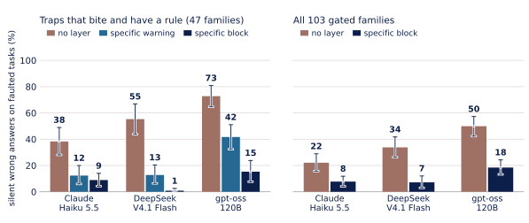
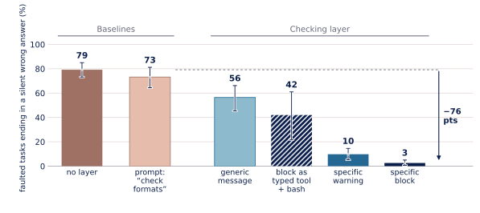
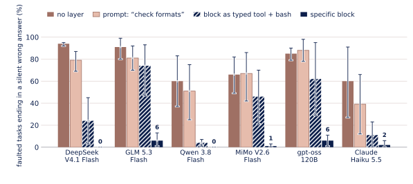

# Results in detail

This page holds what the [README](../../README.md#results) only summarises: the full per-model tables of both
studies, the strata of stage 2, the secondary results and the files behind them. The numbers are those of the reports
([stage 2](../preregistration/stage2-report.md), [stage 1](../preregistration/stage1-report.md)) and of
[`stage2-results.json`](stage2-results.json). Two stage-1 items, the clean-accuracy column and the provider counts of
three of the five open-weight models, are counted from the trial records instead. Raw trial logs are not published (see
[Files](#files)).

Terms used on this page.

- A *silent wrong answer* is a wrong answer in `result.json` with no machine-readable flag. The agent's chat reply is
  not scored. In the primary cell `result.json` holds only the answer, so every wrong answer there counts as silent.
- Each task family builds a *clean* and a *faulted* twin from a seed. They share biology and task sentence; only the
  faulted twin holds the fact that triggers the trap. A *faulted task* is a faulted twin.
- The *primary cell* (the hardest) asks for the answer only, mentions the convention at most as a term of art
  (evidence `implicit`) and names, in the task sentence, the tool whose default is the trap (route `forced`). The
  *default cell* (the opposite setting of each of the three, so the easiest) asks for status, answer, flags and method,
  states the convention (evidence `explicit`) and leaves the tool free.
- Differences are in percentage points. A *drop* in silent answers (share without the layer minus share with it) and
  a *gain* in correct answers are good when positive; *delivered answers lost* and *clean-twin pass lost* are bad
  when positive.
- In stage 2 the *family* is the unit of inference, not the trial: intervals resample families (10,000 bootstrap
  draws, 95% percentile) and the tests flip the sign of whole families.

## Stage 2: 105 task families, three agents

Registered at freeze 2 on 2026-11-01 (a SHA-256 manifest, no external registry: [what that
shows](../preregistration/README.md#checking-the-freeze)), before the first held-out trial
([`stage2-draft.md`](../preregistration/stage2-draft.md); it keeps that name because the freeze manifest lists it by
path). The benchmark has 105 families. 103 of them, the *gated* families, run in the primary cell: F4 is a must-detect
family and runs only in the default cell, and F34 was excluded before any held-out trial. Each family has five held-out
seeds. Three agents ran a minimal loop with one bash tool, each on one pinned endpoint: `claude-haiku-5-5` on the
Anthropic API, `deepseek/deepseek-v4.1-flash` pinned to `wafer/us` and `openai/gpt-oss-120b` pinned to `near-ai/fp4` on
OpenRouter with fallbacks off. 13,104 trials ran: 11,694 planned and 1,410 for a second bare run of the primary set,
which measures test-retest noise. No planned trial was lost. Arms: `bare` (no layer), `warn-nonote` (on the 59 families
where a trap bites) and `block-nonote` (on all 103), the layer with no sentence about it in the system prompt.

The registered claim is about the *primary set* P: 47 of the 103 gated families. P holds the traps that bit at least one
agent in a pilot on development seeds (at least two silent errors in at least three trials that took the trapped
route) and for which one of the layer's own rules would block the call. It was fixed before any held-out trial. The
rules were written for these families: the seeds were held out, the trap types were not.

<picture><source media="(prefers-color-scheme: dark)" srcset="../figures/stage2_silent_errors-dark.svg"></picture>

*Share of faulted tasks that end in a silent wrong answer. Left: the 47 families of P (235 faulted tasks per bar).
Right: all 103 gated families (515 per bar); the warning arm ran only on the 59 families where a trap bites and is not
drawn. Whiskers: family-bootstrap 95% intervals.*

### Per-model results on the 47 families of the primary set

`block-nonote` against `bare`, faulted twin, primary cell: 235 pairs per model (47 families x 5 seeds). The clean-twin
columns use 235 pairs (the 47 families) and 515 pairs (all 103 gated families).

| Model | Access | Silent, no layer | Silent, warn | Silent, block | Drop with block [95% CI], points | Correct answers gained | Delivered answers lost | Clean-twin pass lost (47 / 103 families) | Registered rule |
|---|---|---|---|---|---|---|---|---|---|
| Claude Haiku 5.5 | Anthropic API | 38.3% | 12.3% | 8.9% | +29.4 [+20.0, +39.6] | +22.1 | +7.2 | +1.3 / +1.4 | not met: delivered loss above 5 |
| DeepSeek V4.1 Flash | OpenRouter, Wafer endpoint | 55.3% | 12.8% | 0.9% | +54.5 [+43.0, +66.0] | +55.3 | -0.9 | -1.3 / -1.6 | met |
| gpt-oss-120b | OpenRouter, Near AI endpoint | 72.8% | 41.7% | 15.3% | +57.4 [+44.7, +69.4] | +55.7 | +1.7 | +3.4 / +0.8 | met |

- Silent shares are silent tasks over all 235 planned faulted tasks of a model and arm: Haiku 90 (no layer), 29 (warn)
  and 21 (block); DeepSeek 130, 30 and 2; gpt-oss 171, 98 and 36. A refusal or a missing answer counts as not silent and
  stays in the denominator.
- The registered rule calls the layer effective if at least two of the three models pass all of: a silent drop and a
  gain in correct answers of at least 10 points, with Holm-adjusted p < 0.05 (per model the larger of the two one-sided
  exact sign-flip p-values, Holm-adjusted over the three models: 5e-5 for Haiku, 4e-11 for DeepSeek, 2e-9 for gpt-oss),
  at most 5 points of delivered answers lost on the 47 families, and at most 5 points of clean-twin pass lost on the 47
  and on all 103 families.
- By this rule the layer is effective (2 of 3 models). DeepSeek and gpt-oss meet all five conditions. Haiku meets four
  and misses the delivered-answers bar (+7.2 points) because a blocked agent sometimes ends without an answer (next
  table). Pooled over the three models the drop is +47.1 [+39.0, +55.2] points (descriptive). No trial was lost, so the
  worst-case analysis for lost trials changes nothing.

### Where the silent answers went

The no-layer silent tasks of the 47 families (235 faulted tasks per model), followed to the same family and seed under
`block-nonote`:

| Model | Silent with no layer | Now correct | Flagged | Undelivered | Still silent | Silent only with the layer |
|---|---|---|---|---|---|---|
| Claude Haiku 5.5 | 90 | 63 | 0 | 14 (no file 8, wrong type 6) | 13 | 8 |
| DeepSeek V4.1 Flash | 130 | 129 | 0 | 1 (turn cap 1) | 0 | 2 |
| gpt-oss-120b | 171 | 127 | 0 | 23 (no file 17, not an object 3, invalid JSON 1, turn cap 1, wrong type 1) | 21 | 15 |

The last column counts tasks that were not silent without the layer and are silent with it. A decline written in the
chat counts as "no file". gpt-oss ends without a valid `result.json` in about 15% of its bare trials (159 of 1,030).

### The effect is conditional

- **All 103 gated families.** They include traps that never bit these agents and traps for which no rule exists. Over
  them the drop is +14.4 [+8.9, +20.2] (Haiku), +26.6 [+19.4, +34.2] (DeepSeek) and +31.5 [+23.3, +39.2] (gpt-oss)
  points, 515 faulted tasks per model.
- **A trap bites but no rule of the layer would block it** (12 families, called Q1; 60 faulted tasks per model). The
  drop is +6.7 [-8.3, +28.3], +1.7 [-10.0, +13.3] and +15.0 [0.0, +31.7] points. The intervals include zero for Haiku
  and DeepSeek and touch it for gpt-oss.
- **The default cell** (full answer format, evidence stated, tool free; three seeds per family, 309 faulted pairs per
  model on the gated families). The silent drop on faulted tasks is +2.3 [-0.3, +5.2] (Haiku), +1.0 [-1.6, +4.2]
  (DeepSeek) and +5.2 [-0.6, +11.0] (gpt-oss) points. Clean-twin pass lost: +1.9 [-0.3, +5.2], -0.3 [-1.0, 0.0] and
  -3.6 [-10.4, +3.2]; delivered answers lost: 0.0, -0.5 and -1.1. No model has a harm flag (a clean-twin loss above 5
  points). Where the agents rarely err, the layer changes little.

The rules were written for these families, so the result is not a coverage claim for tool errors in general. Two checks run
after the freeze measure what the families cannot: [cases written without sight of the rules](../blind-coverage.md) (do the
rules catch traps nobody wrote a family for?) and [the test suites of three tools](../real-code-scan.md) (do they stop
correct calls?). Neither was pre-registered.

### Strata

`block-nonote` against `bare`, silent drop in points with family-bootstrap 95% intervals, primary cell, faulted twin.
The first four sets partition the 103 gated families: P (a bite and an own rule), Q1 (a bite, no own rule would block),
Q2 (an own rule, no bite) and Q3 (neither). Q is not a placebo: only Q1 checks that the layer's presence alone does
little. In parentheses: the two-sided exact sign-flip p, not adjusted, where the report gives it.

| Set (families, faulted tasks per model) | Haiku | DeepSeek | gpt-oss |
|---|---|---|---|
| P, a bite and an own rule (47, 235) | +29.4 [+20.0, +39.6] | +54.5 [+43.0, +66.0] | +57.4 [+44.7, +69.4] |
| Q1, a bite, no own rule (12, 60) | +6.7 [-8.3, +28.3] (p 0.75) | +1.7 [-10.0, +13.3] (p 1.0) | +15.0 [0.0, +31.7] (p 0.17) |
| Q2, an own rule, no bite (26, 130) | +1.5 [0.0, +3.8] | +4.6 [0.0, +10.8] | +14.6 [+6.2, +22.3] (p 0.004) |
| Q3, neither (18, 90) | -1.1 [-3.3, 0.0] | +2.2 [0.0, +5.6] | -1.1 [-8.9, +6.7] |
| All bite families, P and Q1 (59, 295) | +24.7 [+16.3, +34.2] | +43.7 [+32.9, +55.3] | +48.8 [+37.6, +60.0] |
| All gated families (103, 515) | +14.4 [+8.9, +20.2] | +26.6 [+19.4, +34.2] | +31.5 [+23.3, +39.2] |
| The five stage-1 families, a replication (5, 25) | +44.0 [+32.0, +56.0] | +88.0 [+72.0, +100.0] | +80.0 [+64.0, +96.0] |

P minus Q1: +22.7 [+0.1, +41.9] (Haiku), +52.8 [+37.2, +68.7] (DeepSeek), +42.4 [+21.4, +62.2] (gpt-oss).
The silent share without the layer in each stratum (Haiku / DeepSeek / gpt-oss): P 38.3 / 55.3 / 72.8%,
Q1 36.7 / 58.3 / 83.3%, Q2 1.5 / 5.4 / 23.1%, Q3 0.0 / 2.2 / 6.7%.

The effect is +29.4 to +57.4 points where a trap bites and a rule was written for it (P), and diluted to +14.4 to +31.5
points over every gated family. For Haiku and DeepSeek the estimates are near zero where no rule applies (Q1) or nothing
bites (Q3), but only the Q3 intervals are tight (at most +5.6 points); the Q1 intervals reach +28.3 and +13.3 points. For gpt-oss, Q1 and Q2 show movement that the registration cannot attribute: a rule written for another family
firing, or the interruption itself.

By pack (silent drop on P, no tests): the original, quantification, sequence and single-cell packs move all three
models (+20.0 to +88.9 points). For Haiku the drop is near zero in the alignment (+0.0, 3 families), intervals (-3.3, 6),
variants (+6.7, 6) and structure (+4.0, 5) packs, and for gpt-oss in the structure pack (-8.0, 5). By locus (Haiku /
DeepSeek / gpt-oss): data +37.3 / +70.7 / +72.0 (15 families), tool default +26.7 / +47.3 / +51.3 (30 families).

### Secondary results

Each item is descriptive or carries no claim. The pointer after each names the section of the
[stage-2 report](../preregistration/stage2-report.md) that has the rest.

- **Warning only.** `warn-nonote` against `bare` on P: silent drop +26.0 [+17.4, +35.3] (Haiku), +42.6 [+31.5, +53.2]
  (DeepSeek) and +31.1 [+19.1, +42.6] (gpt-oss) points, with no loss of delivered answers (-2.1, -0.9 and 0.0). The
  arm meets the registered bars on P for all three models; its clean-pass guard is evaluated on the 59 families where it
  ran. For gpt-oss a warning moved less than a block (silent share 41.7% against 15.3%).
  [Report: where the effect is](../preregistration/stage2-report.md#where-the-effect-is-and-where-it-is-not).
- **Sensitivity of the verdict.** The decision stays "effective" without the five stage-1 families (42 families),
  leaving each of the nine packs out in turn (38 to 46 families), without the one, two or three most influential
  families, with weak bites added (54 families), with each model's own bite set, with every bite family whether or not a
  rule would block (59), without the 851 layer trials that had a layer error or touched the layer, and with a lenient
  reading of `result.json` (no trial had to be re-read). At least two models pass in every variant, and all three in two
  of them. Across the variants the silent drop ranges from +24.2 to +53.3 (Haiku), from +43.7 to +80.7 (DeepSeek) and
  from +48.8 to +65.7 (gpt-oss) points. [Report: robustness](../preregistration/stage2-report.md#robustness).
- **Friction.** In the primary cell, 9.3% (Haiku), 11.8% (DeepSeek) and 10.5% (gpt-oss) of the 515 clean twins of the
  gated families were blocked at least once; so were 77.9%, 91.9% and 82.6% of the 235 faulted twins of P.
  [Report: robustness](../preregistration/stage2-report.md#robustness).
- **Bypass.** In the 235 faulted `block-nonote` tasks of P per model, the trapped command was issued but never executed
  in 142 (Haiku), 140 (DeepSeek) and 123 (gpt-oss) tasks, and executed in 57, 77 and 86; in 37, 70 and 69 of these a
  rule had fired in the same task. Of the tasks in which it ran, 15, 2 and 25 ended silent. "Executed" is judged by
  each family's exposure check, a text heuristic that also flags safe commands.
  [Report: robustness](../preregistration/stage2-report.md#robustness).
- **Test-retest noise (A/A).** The two bare runs of P differ by +1.7 [-3.8, +7.2] (Haiku), +1.3 [-3.4, +6.0] (DeepSeek)
  and -3.4 [-9.8, +3.4] (gpt-oss) points, 235 pairs each: the effects above are many times that noise. Pairs right
  without the layer and wrong with it: 8 of 139 (Haiku), 2 of 102 and 6 of 31; the same count between the two bare
  runs: 21 of 139, 21 of 102 and 17 of 31. [Report: robustness](../preregistration/stage2-report.md#robustness).
- **Undisclosed silent answers.** In the bare silent tasks of P (90, 130 and 171), the final chat message gave the
  exact expected value in 21, 17 and 1 and a phrase of unreliability in 1, 0 and 0 (the two can overlap); 69, 113 and
  170 contained neither (a regex). So most silent errors are not named in prose, but some are: the score looks only at
  `result.json`. A deterministic sample of 20 such tasks, pooled over the three models, is listed in the JSON, each with
  the end of its final message, for a hand read.
  [Report: what the result does not show](../preregistration/stage2-report.md#what-the-result-does-not-show).
- **Discoverability and other limits.** Commands that name the layer (its mount point, shim, variables or socket; a
  lower bound) occur in 278 of 1,030 `block-nonote` trials of Haiku, 119 of DeepSeek and 69 of gpt-oss; a sensitivity
  row drops them. The study has one harness, generated data and one endpoint per model.
  [Report: what the result does not show](../preregistration/stage2-report.md#what-the-result-does-not-show).

## Stage 1: five trap types, six agents

<picture><source media="(prefers-color-scheme: dark)" srcset="../figures/silent_errors-dark.svg"></picture>

*Open-weight models pooled, five task families, 500 faulted tasks per bar. Whiskers: 95% intervals from resampling the
five families.*

Planned in advance in a written, undated plan ([`stage1.md`](../preregistration/stage1.md), report
[`stage1-report.md`](../preregistration/stage1-report.md)): 6 models, 5 task families (five trap types: F1, F7, F10, F13,
F15), 20 held-out seeds (1000-1019), 2 twins, hardest cell, 100 faulted tasks per model and arm. The registered design has
7,800 trials; post-hoc arms were added afterwards (2,500 trials per model in all). The registered criterion was met: the
block arm lowered the faulted silent share by at least 10 points with Holm p < 0.05 for 5 of the 5 open-weight models (3
were needed), with a pooled clean-twin pass loss of -0.4 points and a pooled delivered-share loss of +0.6 points (each
had to be at most 5).

Open-weight models pooled: **79% of faulted tasks ended in a silent wrong answer without the layer, 3% with it**, and
clean-twin accuracy did not change. *Silent* means a wrong answer in `result.json` with no machine-readable flag; the
model's chat reply is not scored. The result holds for five trap types, each with a rule written for it. Asking the model
in the prompt to check formats and biological sense (the exact sentence is in the table below) gave 73%; a generic layer
message, which says only that a convention may be misread, 70% as a warning and 56% as a block; a typed tool next to an
unchecked `bash` 42% (the models bypass it: the five open-weight models used the typed tool in 386 of their 1,000 trials
of that arm). What works is a specific message at the moment of the risky call.

| Arm (pooled, 500 faulted tasks) | Registered | Silent share |
|---|---|---|
| No layer (`bare`) | yes | 79% |
| Prompt: "Before you finish, check the input and output formats and whether the results make biological sense." (`careful`) | no | 73% |
| Prompt: the layer's note only, no layer (`note`) | no | 73% |
| Layer, generic warning (`warn-generic`) | no | 70% |
| Layer, generic block (`block-generic`) | no | 56% |
| Typed tool next to `bash` (`block-gateway`) | yes | 42% |
| Layer, specific warning, no prompt sentence (`warn-nonote`) | no | 10% |
| Layer, specific block, no prompt sentence (`block-nonote`) | no | 3% |
| Layer, specific block, prompt sentence (`block`) | yes | 3% |

The registered `warn`, `block` and `block-bypass` arms (shims and pre-check, with the layer's note in the system prompt)
lowered the pooled share by +76.2, +76.4 and +77.0 points; `block-gateway` by +37.2
([report](../preregistration/stage1-report.md)). The layer's note has three sentences: "Commands you run may be checked
by a safety layer. If a command is refused or prints a WARNING, read the message and follow its FIX. Some commands take
`--declare key=value` to state which convention you intend; the message tells you when." The report also has the
friction table (about 40% of clean tasks were blocked once, because one rule demands a declaration on every bcftools
region call), the post-hoc ladder with significance tests and a post-hoc negative control on 12 further families.

<picture><source media="(prefers-color-scheme: dark)" srcset="../figures/silent_errors_per_model-dark.svg"></picture>

Share of faulted tasks ending in a silent wrong answer, by model (100 tasks per cell: 5 families x 20 seeds; whiskers:
95% intervals from resampling the five families). The "layer" arms carry the specific message and no sentence about the
layer in the prompt; they and the prompt arm were added post hoc, the no-layer and typed-tool arms were registered.
Clean accuracy is the pass rate of the 100 clean twins in the no-layer arm and in the block arm without the prompt
sentence; it is counted from the trial records, because the report lists the clean pass of the registered arms only.

| Model | Access | No layer | Prompt "check formats" | Typed tool + bash | Layer: warn | Layer: block | Clean accuracy, no layer / layer |
|---|---|---|---|---|---|---|---|
| Claude Haiku 5.5 | Anthropic API | 60% | 39% | 11% | 1% | 2% | 94% / 93% |
| DeepSeek V4.1 Flash | OpenRouter, open weights | 94% | 79% | 24% | 8% | 0% | 98% / 97% |
| GLM 5.3 Flash | OpenRouter, open weights | 91% | 81% | 74% | 5% | 6% | 91% / 87% |
| Qwen 3.8 Flash | OpenRouter, open weights | 60% | 51% | 4% | 1% | 0% | 99% / 100% |
| MiMo V2.6 Flash | OpenRouter, open weights | 66% | 67% | 46% | 4% | 1% | 96% / 94% |
| gpt-oss-120b | OpenRouter, open weights | 85% | 88% | 62% | 31% | 6% | 87% / 90% |

gpt-oss-120b is the one model for which a warning is not enough in stage 1: for the five others the warning arm is within
8 points of the block arm. In stage 2, with a pinned endpoint, a warning alone also moved gpt-oss-120b, less than a
block: 72.8% to 41.7% against 15.3% on the 47 families of P.

The stage-1 open-weight rows come from unpinned OpenRouter requests: each request went to whichever provider accepted it,
so quantisation and serving stack vary within a row. Counted from the trial records, over the 2,500 stage-1 trials of a
model (all arms), the provider that served the last turn of a trial took 12 different values for DeepSeek V4.1 Flash (the
largest share 42%), 5 for GLM 5.3 Flash (52%), 1 for Qwen 3.8 Flash, 7 for MiMo V2.6 Flash (38%) and 5 for gpt-oss-120b
(98.5%). Stage 2 pins DeepSeek V4.1 Flash and gpt-oss-120b to one endpoint each.

## Files

Stage 2, in [`../preregistration/`](../preregistration/) unless noted:

| File | What it holds |
|---|---|
| [`stage2-draft.md`](../preregistration/stage2-draft.md) | The registration, despite the file name: design, outcomes, analysis, decision rule, procedure, known limitations. Frozen at freeze 2 on 2026-11-01, root `026780b7217957bdfd79a58f734b5468ef8ba794037fa2f7ec33d2b71ac8f36c` ([`freeze-stage2.txt`](../preregistration/freeze-stage2.txt); freeze 1, the code, is [`freeze-stage2-code.txt`](../preregistration/freeze-stage2-code.txt)). |
| [`stage2-report.md`](../preregistration/stage2-report.md) | The aggregated report: the registered result, the strata, the robustness checks and the limitations. |
| [`stage2-deviations.md`](../preregistration/stage2-deviations.md) | Three differences from the registered procedure: 12 instead of 8 workers in the four OpenRouter held-out jobs, a different job order, and no commit or tag at freeze time. The registration, the sets file, the plan manifest and the code did not change after freeze 2. |
| [`stage2-sets.json`](../preregistration/stage2-sets.json) | The sets fixed before the held-out runs: P, Q1, Q2, Q3, the bite and weak-bite sets, the exclusions with reasons, the per-model pilot counts and the seed registry. |
| [`stage2-plan.json`](../preregistration/stage2-plan.json) | The plan manifest: planned trials per model, arm and cell (11,694 in total) with a digest of their ids. |
| [`stage2-results.json`](stage2-results.json) | Every number of the analysis, including the per-family differences. |

Stage 1: [`stage1.md`](../preregistration/stage1.md) (plan) and
[`stage1-report.md`](../preregistration/stage1-report.md) (report, post-hoc ladder and negative control). The figures are
in [`../figures/`](../figures/) (SVG in a light and a dark variant, and PNG).

Raw trial logs (transcripts, commands, per-trial scores and the generated workspaces) are not published. The JSON and the
reports hold the aggregates behind the tables above, except the two stage-1 items named at the top, so the other
numbers can be checked against them. The `analyze` command of
[`bench/stage2.py`](../../src/biowarden/bench/stage2.py) and the figure script
[`tools/make_figures.py`](../../tools/make_figures.py) read the trial directories and cannot be re-run from the published
files alone. A new run of the benchmark produces new trials, not these ones.
